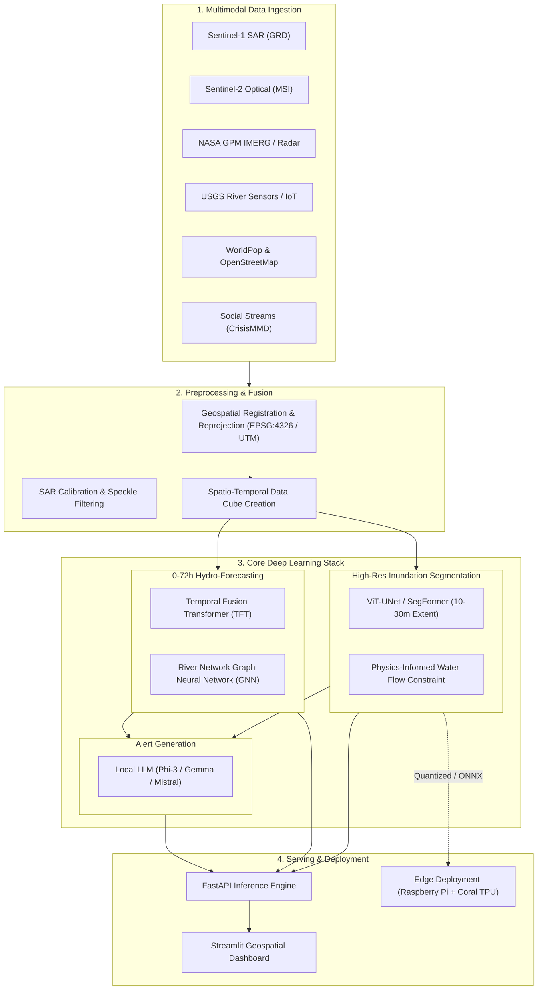

# Flood-AI: Real-Time Flood Early Warning and Evacuation Guidance System

[](https://www.python.org/downloads/)
[](https://pytorch.org/)
[](https://fastapi.tiangolo.com)
[](https://streamlit.io)
[](LICENSE)

---

## 🌊 Vision & Problem Statement

Climate change is accelerating extreme weather events, leading to more frequent, destructive, and unpredictable floods globally. Traditional flood forecasting systems often rely exclusively on sparse physical gauges or low-resolution hydrologic simulations that fail to predict localized, high-resolution flood extents in real time. 

**Flood-AI** bridges this critical gap. It is an end-to-end, multimodal, production-grade disaster early warning and evacuation guidance platform that:
- Ingests and harmonizes multi-source Earth Observation (EO) data: **Sentinel-1 SAR**, **Sentinel-2 Multispectral**, **GPM IMERG** precipitation, **ERA5** reanalysis, **USGS river gauges**, **OpenStreetMap**, **WorldPop**, and crisis social streams.
- Performs spatio-temporal multimodal data fusion.
- Predicts flood extent, inundation depth, and overflow probability at **10–30 meter resolution**, **0–72 hours in advance**.
- Employs open-source small LLMs (e.g., Phi-3 / Gemma / Mistral) to synthesize complex telemetry into clear, localized, multi-lingual, and plain-language evacuation advisories.
- Supports dual deployment targets: High-throughput **Cloud Microservices (Kubernetes / Docker)** and low-power, disconnected **Edge nodes (Raspberry Pi 5 + Google Coral TPU)** for resilient frontline operations.

---

## 🏛️ System Architecture



---

## 📂 Project Structure

```
flood-ai/
├── README.md                           # Project documentation & guidelines
├── requirements.txt                    # Python environment specifications
├── .gitignore                          # Git tracking rules
├── data/
│   ├── raw/                            # Raw satellite scenes, gauge CSVs, geo-jsons
│   ├── processed/                      # Preprocessed arrays, tiles, and data cubes
│   └── external/                       # Population (WorldPop), roads, buildings (OSM)
├── notebooks/
│   ├── flood_ai_master_pipeline.ipynb  # Unified master pipeline (Ingestion ➔ EDA ➔ ViTUNet ➔ TFT ➔ Alerts)
│   └── flood_ai_master_pipeline.py     # Interactive Python script equivalent with VS Code cell markers
├── src/
│   ├── data/
│   │   ├── ingest_sentinel.py          # Automated Sentinel-1 SAR & Sentinel-2 optical pipeline
│   │   ├── ingest_radar.py             # Weather radar / GPM IMERG ingestion
│   │   ├── ingest_sensors.py           # USGS and IoT river stage data extraction
│   │   ├── ingest_social.py            # Multimodal crisis social media ingestion
│   │   ├── fusion.py                   # Spatio-temporal alignment and raster fusion
│   │   └── preprocess.py               # Spatial tiling, clipping, and normalization
│   ├── models/
│   │   ├── segmentation/
│   │   │   ├── vit_unet.py             # Vision Transformer + U-Net for SAR/optical segmentation
│   │   │   ├── convlstm.py             # Spatio-temporal recurrent baseline
│   │   │   └── physics_informed.py     # Elevation & hydro-continuity regularizers
│   │   ├── forecasting/
│   │   │   ├── tft_model.py            # Temporal Fusion Transformer for multi-horizon river levels
│   │   │   └── gnn_river.py            # Graph Neural Network modeling topology of river reaches
│   │   ├── llm_alert.py                # Local LLM evacuation & risk advisory synthesis
│   │   └── utils.py                    # Model weights loading, freezing, and loss functions
│   ├── training/
│   │   ├── train_segmentation.py       # Distributed PyTorch training loop for segmentation
│   │   ├── train_forecast.py           # TFT training pipeline with MLflow tracking
│   │   └── train_gnn.py                # PyTorch Geometric training on gauge graphs
│   ├── inference/
│   │   ├── realtime_pipeline.py        # End-to-end streaming inference orchestrator
│   │   ├── edge_inference.py           # Quantized ONNX / TFLite runtime for Coral TPU
│   │   └── alert_generator.py          # Geo-targeted alert compilation
│   ├── evaluation/
│   │   ├── metrics.py                  # IoU, F1-Score, Critical Success Index (CSI), RMSE
│   │   └── visualize.py                # Publication-quality spatial overlays & flood maps
│   └── api/
│       ├── fastapi_app.py              # REST API for inference, telemetry & alerts
│       └── streamlit_dashboard.py      # Real-time interactive map dashboard
├── deployment/
│   ├── docker/
│   │   ├── Dockerfile                  # Container definition with GDAL & PyTorch
│   │   └── docker-compose.yml          # Multi-container orchestration (API + Dashboard + MLflow)
│   ├── edge/
│   │   ├── raspberry_pi/               # Setup scripts for Raspberry Pi 5
│   │   └── coral_tpu/                  # EdgeTPU compiler & delegate instructions
│   └── k8s/
│       └── deployment.yaml             # Kubernetes manifests for scalable cloud serving
├── tests/
│   ├── test_data.py                    # Data pipeline verification tests
│   ├── test_models.py                  # Model forward pass, shape, and loss unit tests
│   └── test_inference.py               # Latency & edge compatibility tests
├── docs/
│   └── architecture.md                 # In-depth architectural design specifications
└── scripts/
    └── download_data.sh                # Automated downloader for public benchmark datasets
```

---

## 📊 Core Datasets & Citations

1. **Sen1Floods11**: A georeferenced dataset for flood detection with Sentinel-1 SAR and permanent water labels across 11 flood events.
   - *URL*: [https://github.com/cloudtostreet/Sen1Floods11](https://github.com/cloudtostreet/Sen1Floods11)
2. **Sen2Floods**: Harmonized Sentinel-2 optical flood extent dataset.
   - *URL*: [https://github.com/cloudtostreet/Sen2Floods](https://github.com/cloudtostreet/Sen2Floods)
3. **xBD**: Building damage assessment dataset with pre- and post-disaster satellite imagery.
   - *URL*: [https://github.com/DARPA-XBD/xBD](https://github.com/DARPA-XBD/xBD)
4. **NASA GPM IMERG**: Global Precipitation Measurement half-hourly and daily rainfall products.
   - *URL*: [https://gpm.nasa.gov/data/imerg](https://gpm.nasa.gov/data/imerg)
5. **ECMWF ERA5**: Hourly reanalysis for atmospheric moisture, runoff, and precipitation.
   - *URL*: [https://cds.climate.copernicus.eu/](https://cds.climate.copernicus.eu/)
6. **USGS National Water Information System**: Real-time river discharge and stage height measurements.
   - *URL*: [https://waterdata.usgs.gov/nwis](https://waterdata.usgs.gov/nwis)
7. **WorldPop & OpenStreetMap**: High-resolution population density grids and infrastructure layers for vulnerability calculation.
   - *URL*: [https://www.worldpop.org/](https://www.worldpop.org/) | [https://www.openstreetmap.org/](https://www.openstreetmap.org/)
8. **CrisisMMD**: Multimodal social media dataset with geolocation for disaster response.
   - *URL*: [https://github.com/368411914/CrisisMMD](https://github.com/368411914/CrisisMMD)
